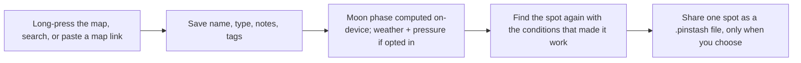

  <picture>
    <source media="(prefers-color-scheme: dark)" srcset="branding/pinstash-wordmark-on-dark.png">
    
  </picture>

  
<strong>Pin it. Stash it. Keep it yours.</strong>

     

> **Showcase repository.** The source code for Pinstash is not published. This page presents what the product is and how it works.

## Overview

A private log for fishing and hunting spots. Drop a pin on the map or use your current location, save the spot with the conditions, and note what worked. Everything stays on the phone.

## How it works

## Features

- Topographic map: Standard, USGS Topo, Satellite, shaded relief, plus a reference-only public-land layer
- Paste Google/Apple Maps links or typed coordinates
- GPX and KML import/export with a review step
- Password-protected backup and restore (PBKDF2 + AES-GCM)
- Opt-in weather and pressure from the US National Weather Service
- App-switcher privacy cover, offline banner, versioned on-device database
- Local profile only, no cloud account

## Tech stack

| Layer | Choice |
|---|---|
| Language / UI | Swift, SwiftUI, SwiftData, iOS 17+ |
| Maps | MapKit + USGS topo tiles |
| Weather | api.weather.gov (opt-in) |
| Crypto | Apple CryptoKit |
| Tests | PinstashTests |

## Privacy & security

Spots are never uploaded. No account, no analytics, no third-party SDKs. Sharing is user-initiated and server-free.

## Brand

| | Name | Hex | Role |
|---|---|---|---|
|  | Deep Water | `#0B3C49` | Icon field, text, dark surfaces |
|  | Gold | `#FFB703` | Pin, accent, key actions |
|  | Ripple | `#5CC8E8` | Water rings, accents on dark |
|  | Sand | `#FFF4D6` | Light surfaces |

**Mark.** A gold map pin with a keyhole cutout over water ripples: a private spot, locked away and kept yours.

**Voice.** Quiet and discreet, like a fishing buddy who keeps a secret. Plain words. Never imply anything is shared or uploaded.

## Roadmap

- Subscription via StoreKit 2 (free core, Pro: weather, offline topo, land layer)
- Offline topo maps
- Share-sheet extension
- Accessibility audit

## License

Proprietary. Shared publicly for portfolio and demonstration purposes only. See [LICENSE](LICENSE).

---

Built by [Aquila Digital LLC](https://github.com/Steven6Brown) · *Per Aspera Ad Astra*

